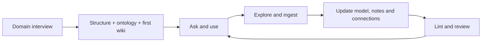

# AKM — Agent Knowledge Management

**Build and keep improving a knowledge system for your own domain: a connected ontology, an LLM wiki, and the structure to operate them.**

Use one entry point, **`$akm` in Codex or `/akm` in Claude Code**, from the first interview through ongoing research, expansion, connection repair, validation, and resumption. AKM routes the work across 14 specialist roles. Markdown and source files stay yours; no database, server, paid API, or gstack installation is required.

[한국어](README.ko.md) · [Skill guide](skill-suite/README.md) · [All 15 skills](skill-suite/README.md#스킬-구성) · [Runnable example](skill-suite/examples/reading-club/index.md) · [Validation and limits](skill-suite/VALIDATION.md)

## What you build

| Part | What it does |
|---|---|
| **AKM structure** | Chooses where sources, knowledge, context, procedures, and verification belong, based on how you work. An inbox and dedicated operating layers are optional. |
| **Ontology** | Defines concepts, entity types, relationship meanings, applicable conditions, exceptions, and evidence. |
| **LLM wiki** | Synthesizes readable explanations that answer your questions and point back to the same concepts, claims, and sources. |
| **Ongoing operation** | Finds gaps, researches evidence, updates existing knowledge, adds justified connections, checks results, and saves the next step. |

Ontology and wiki share stable IDs, definitions, claims, sources, and revisions. When a rule changes, the agent updates its model, affected explanations, examples, and answers together. Folder names alone do not define an ontology, and a link alone does not prove a relationship. See the [connected knowledge contract](skill-suite/akm/skills/akm/references/linked-knowledge.md).

The domain comes from you: a research topic, a craft, an organization's work, a creative practice, or another field. Questions follow your actual examples and decisions. Existing knowledge spaces retain their structure and local rules.

## Install once, start with your domain

With Python 3.10+, choose your host:

```sh
git clone https://github.com/DECK6/akm.git
cd akm
# Codex (the default)
python3 skill-suite/akm/scripts/install.py
# Claude Code
python3 skill-suite/akm/scripts/install.py --host claude
```

The installer links all 15 skills into `CODEX_HOME/skills` (or `~/.codex/skills`) for Codex, or `CLAUDE_CONFIG_DIR/skills` (or `~/.claude/skills`) for Claude Code. Keep the clone in place. Re-running adds missing roles without replacing conflicting entries; `--dest` selects another skill directory. The [installation guide](skill-suite/README.md#로컬-설치) covers the plugin source and other agent environments. Automatic skill discovery depends on the host. Use `$akm` in Codex or `/akm` in Claude Code. Both share the same skill bodies and knowledge contracts.

For a session-only Claude plugin, run `claude --plugin-dir /absolute/path/to/akm/skill-suite/akm` and invoke `/akm:akm`. This is an alternative to the direct skill installation; no marketplace registration is required. See the [Claude Code guide](adapters/claude-code/README.md).

Start with any of these (replace `$akm` with `/akm` in Claude Code):

> $akm Build a knowledge system for my field. Interview me about the questions, examples, and decisions that matter, then help me build the ontology and wiki.

> akm 구축 시작해줘
>
> 온톨로지 구축 시작해줘
>
> llm wiki 구축 시작해줘

All three enter the same domain discovery interview. The agent asks related questions in groups, follows your answers into deeper questions, and continues until you say nothing more comes to mind or ask to proceed, pause, or skip. It uses the information already supplied.

The interview determines whether you need an inbox, the depth of your knowledge layer, and the operating layers you want. The first wiki contains **three substantive notes**, with a shared meaning model and source links. Later updates create or revise only what the questions require.

To update an installation made from this clone:

```sh
git pull --ff-only
python3 skill-suite/akm/scripts/install.py             # Codex
python3 skill-suite/akm/scripts/install.py --host claude  # Claude Code
```

## Keep using the same entry point

You do not need to memorize role names. Ask `$akm` (Codex), `/akm` (Claude Code), or use a natural-language request:

| Your request | What the agent does |
|---|---|
| “Add this source to my knowledge.” | Preserves the source, compares its claims with existing knowledge, updates the model and wiki, then verifies affected answers. |
| “What should I investigate next?” | Identifies unanswered questions, weak evidence, missing conditions, and counterexamples; recommends useful investigations. |
| “Expand this domain for me.” | Runs research, ingestion, synthesis, connection repair, and checks within the delegated scope and budget. |
| “Find and fill the missing connections.” | Inspects isolated notes and missing model mappings, adds evidence-backed relationships or useful navigation links, and checks their meaning. |
| “Check how complete this knowledge is.” | Checks structure, evidence, declared questions, conditions, counterexamples, and unknowns; reports gaps and next actions. |
| “Start another field in this workspace.” | Interviews for the new domain and adds its own brief, model, notes, and state while preserving existing domains. |
| “Continue where we stopped.” | Reads the actual revision and unfinished tasks, resumes useful work, and avoids ingesting the same material again. |



The agent uses the roles needed for your request. A simple question remains a query; a delegated maintenance task proceeds through actual changes and verification. New evidence can strengthen an existing note, revise a condition, expose a conflict, or justify a new note. If nothing new is supported, **no change is a valid result**.

### Give autonomous work a clear scope

For example:

> $akm Maintain my urban gardening knowledge. Use the sources already in this workspace, work through at most three useful tasks, repair missing connections, and check the updated answers. Save what remains for the next session.

Maintenance records the domain, allowed sources and actions, task/source/time limits, current revision, outcomes, and next step. It stops when the scope is satisfied, a limit is reached, you stop it, or there is no supported progress to make. See the [lifecycle contract](skill-suite/akm/skills/akm/references/lifecycle.md).

A skill runs through your current agent. Installing it does not start an unattended service. Recurring execution can be connected to a host scheduler when requested; the agent must verify registration before reporting it active.

## Check the ontology and wiki together

The suite separates **mechanical integrity** from **semantic review**:

| Check | Scope |
|---|---|
| `lint` | IDs, references, relationship endpoint types, source-read status and passage locators, local files, ordinary Markdown links, and stale file fingerprints. |
| `coverage` | Answer notes and current normal/counterexample/unknown check records for the questions you declared. |
| `frontier` | Turns findings into candidate exploration, connection, or review tasks. |
| `impact` | Traces a changed source, concept, relation, or claim to affected claims, notes, and questions. |
| Semantic review | Reads actual source passages and explanations to assess support, meaning, conditions, contradictions, and answer quality. |

Try the read-only CLI on the [fictional reading-club example](skill-suite/examples/reading-club/index.md), from the repository root:

```sh
python3 skill-suite/akm/scripts/knowledge.py lint --root skill-suite/examples/reading-club --map skill-suite/examples/reading-club/knowledge-map.json
python3 skill-suite/akm/scripts/knowledge.py coverage --root skill-suite/examples/reading-club --map skill-suite/examples/reading-club/knowledge-map.json
python3 skill-suite/akm/scripts/knowledge.py frontier --root skill-suite/examples/reading-club --map skill-suite/examples/reading-club/knowledge-map.json
python3 skill-suite/akm/scripts/knowledge.py impact --root skill-suite/examples/reading-club --map skill-suite/examples/reading-club/knowledge-map.json --id S1
```

Existing Markdown, JSON, or RDF models stay in place. The agent builds a [hashed inspection map](skill-suite/akm/skills/akm/references/audit-map.md) from the relevant canonical files. That map is derived data; it must be refreshed from the actual content after changes.

**Completeness is relative to your declared questions and scope.** A clean lint result does not establish factual truth. The CLI does not inspect unregistered files, prove source support, or perform OWL/RDF reasoning; semantic review and format-specific checks remain separate.

## What has been exercised

The [validation record](skill-suite/VALIDATION.md) distinguishes automated checks and synthetic behavior exercises. These include initial interviews, connected notes, rule changes propagated through model and wiki, a bounded maintenance cycle, missing-connection repair, and a second cycle that preserved knowledge without duplicate ingestion. This is evidence for those scenarios, not a guarantee across every domain or agent host.

## The portable Markdown core

The original public AKM core is part of the wider system. Use it directly through the adapters below, or let `akm-structure` select the storage roles your domain needs. The skill suite contains a pinned, licensed baseline; existing workspaces keep their own policies.

### Storage roles

These are the baseline storage roles. A new workspace built through the skill interview creates only the selected layers; source traceability and correction still apply when a dedicated folder is omitted. Existing workspaces keep their own INDEX, ROUTER, SCHEMA, and LOOP.

| # | Layer | Folder | One-line rule |
|---|-------|--------|---------------|
| 1 | Source | `10-sources/` | Originals, never modified. Provenance tracked |
| 2 | Knowledge | `20-knowledge/` | Compiled, reusable knowledge — true for anyone |
| 3 | Context | `30-context/` | True only for this user / org / project / domain |
| 4 | Operational Memory | `40-memory/` | Short, stable pointers the agent must know every session |
| 5 | Procedural | `50-procedures/` | How to execute — skills, workflows, checklists |
| 6 | Action | `60-actions/` | Selected execution records — only what's needed for reproduction, verification, handoff |
| 7 | Evaluation | `70-evaluation/` | Failure patterns, rubrics, audits — where failures become learning |

Plus two auxiliary layers: `80-outputs/` (deliverables) and `90-archive/` (deprecated notes).

## Three stores: memory, brain, vault

The seven layers group into three stores — the agent's mental model for *when* things get read:

```text
┌─ MEMORY  what loads every session ········ 40-memory
├─ BRAIN   how the agent works ············· 50-procedures · 60-actions · 70-evaluation
└─ VAULT   what the agent knows ············ 10-sources · 20-knowledge · 30-context · 80-outputs
```

- **Memory** is read first, always. Pointers only.
- **Brain** is read when acting: the procedure to follow, past decisions, failure patterns to avoid.
- **Vault** is read when knowledge is needed: sources, compiled knowledge, context, deliverables.

The layers define *storage semantics* (what goes where); the stores define *loading behavior* (when it gets read). If your agent already has its own brain or memory system, see [`adapters/custom/`](adapters/custom/README.md) — keep it native, connect by pointers.

## The loop

```text
1. Ingest → 2. Classify → 3. Compile → 4. Contextualize → 5. Execute → 6. Verify → 7. Learn Back
                                                                                        │
                                                  ┌─────────────────────────────────────┘
                                                  ▼
                                   (the layer that gets fixed improves the next run)
```

Accumulating knowledge without steps 5–7 is just a wiki. Executing without 6–7 is just automation. **Learn Back** — routing every failure to the layer that must change — is what makes it AKM. See [`99-system/LOOP.md`](99-system/LOOP.md).

Verification is risk-based: Tier 0 for low-risk one-offs, Tier 1 for durable notes, Tier 2 for deep reports, and Tier 3 for high-stakes work with a claim ledger. The seven-dimension standard is informed by the DEER benchmark and connects request fit, reasoning, structure, style, safety, evidence sufficiency, and evidence integrity to Learn Back. See [`99-system/VERIFICATION.md`](99-system/VERIFICATION.md).

## Use the Markdown core directly

```bash
git clone https://github.com/DECK6/akm.git
cd akm
```

Root [`CLAUDE.md`](CLAUDE.md) and [`AGENTS.md`](AGENTS.md) provide operating instructions for agents that load those files from a project. Use a matching adapter below when your host needs an explicit entry point.

To use AKM from anywhere:

1. **Pick your adapter** in [`adapters/`](adapters/):
   - [Claude Code](adapters/claude-code/README.md) → paste the snippet into `~/.claude/CLAUDE.md` or a project `CLAUDE.md`
   - [Codex](adapters/codex/README.md) → paste into `~/.codex/AGENTS.md` or a repo `AGENTS.md`
   - [OpenClaw](adapters/openclaw/README.md) → paste into your workspace `AGENTS.md`
   - [Hermes](adapters/hermes/README.md) → paste into each profile's session-loaded instruction file
   - [Aside](adapters/aside/README.md) → connect Aside instructions and native-memory pointers
   - [Any other agent](adapters/custom/README.md) → four questions every adapter must answer
2. **Replace `/path/to/akm`** in the snippet with your clone location.
3. **Use it.** Ask your agent to store or find anything. The snippet points it to the routing rules (`99-system/ROUTER.md`) and the loop (`99-system/LOOP.md`); everything else follows.

Your notes can be in any language — only the system files are English.

AKM can also be opened directly as an Obsidian vault. Local `.obsidian/` application state is ignored by default, so the same folder remains a portable Markdown knowledge system.

If you already have a Markdown or Obsidian vault, migrate it in bounded phases instead of copying everything at once: freeze the folder-to-layer mapping, move one representative slice, repair links, lint and reindex, then expand only after the slice passes. See [`99-system/MIGRATION.md`](99-system/MIGRATION.md).

## Storage rules in 30 seconds

- **Memory (40)** only if *all* hold: short, stable, needed repeatedly, must be known before acting, a pointer suffices. Never put long knowledge here.
- **Knowledge (20)** if it's worth re-reading, reusable across projects, or domain knowledge itself.
- **Procedure (50)** only if *all* hold: repeated, has steps, has known failure points, has a verification method.
- **Evaluation (70)** if a failure may repeat, or a quality bar / verification method is needed.
- **Action (60)**: store only what reproduction, verification, or handoff requires. Everything else, drop.

Full decision tree: [`99-system/ROUTER.md`](99-system/ROUTER.md).

## OKF export

AKM can export selected layers as an OKF-compatible Markdown bundle without changing the internal AKM schema:

```bash
node scripts/export-okf.mjs --out dist/okf
node scripts/lint.mjs --okf-export dist/okf
```

The export maps `akmType` to OKF `type`, keeps `akmType` internal, converts wikilinks to standard Markdown links, writes root `okf_version: "0.1"` metadata, and generates lowercase `index.md` files for OKF consumers. See [`99-system/OKF-COMPAT.md`](99-system/OKF-COMPAT.md).

## Linting

Validate your instance — frontmatter schema, enum values, layer placement, broken wikilinks, INDEX consistency, and common secret patterns:

```bash
node scripts/lint.mjs --akm
node scripts/lint.mjs --links
node scripts/lint.mjs --secrets
node scripts/lint.mjs --okf-export ./dist/okf
node scripts/lint.mjs --task-contract ./path/to/contract.md
node scripts/lint.mjs --instructions ./path/to/instruction-manifest.json
node scripts/lint.mjs --routing-failure ./path/to/failure-note.md
node scripts/lint.mjs --prompt-assets ./path/to/prompt-asset-manifest.json
```

Repository tests use Node's built-in runner and Python's standard library:

```bash
node --test scripts/tests/*.test.mjs
python3 -m unittest discover -s skill-suite/tests -v
```

The [skill validation record](skill-suite/VALIDATION.md) distinguishes automated checks, synthetic behavior exercises, and host integration limits. GitHub Actions runs both test suites.

Schema violations and OKF conformance failures are errors (exit 1); link/index/secret findings are warnings. Managed AKM notes use the complete schema. Unmodified Markdown originals in `10-sources/` and opaque deliverables in `80-outputs/` may omit AKM frontmatter; if either uses an `akmLayer`, `akmType`, or `akmRole` field, the full schema applies. See [`99-system/SCHEMA.md`](99-system/SCHEMA.md).

The script checks deterministic structure; it cannot decide whether an artifact answered the request or whether a cited source truly supports a claim. Tier 1+ verification adds those request-fit and claim-support checks through [`99-system/VERIFICATION.md`](99-system/VERIFICATION.md).

Security and privacy rules — never store secret values, layers never leave the machine, review outputs before sharing — live in [`99-system/SECURITY.md`](99-system/SECURITY.md).

## Evidence and bounded execution

AKM v0.3 adds two portable contracts learned from a production instance without making its local policies part of the public core:

- [`99-system/EVIDENCE-SCHEMA.md`](99-system/EVIDENCE-SCHEMA.md) separates retrieved candidates, direct reads, named claim support, conflicts, and reproducible evidence packets. Derived indexes remain disposable; Markdown and original sources remain canonical.
- [`99-system/TASK-CONTRACT-SCHEMA.md`](99-system/TASK-CONTRACT-SCHEMA.md) defines bounded artifact work with exact outputs, one canonical path, explicit ownership, failure handling, verification readback, security exclusions, and a 90-minute maximum runtime.

The four enforcement modes are read-only and fail closed. They validate declared structure; they do not create work, authorize external actions, or replace Tier 0–3 verification. See [`99-system/ENFORCEMENT.md`](99-system/ENFORCEMENT.md).

## Large assets

Keep large binaries outside the text vault and mirror their AKM-relative paths under a separate asset root. Store paths, provenance, checksums, and verification notes in Markdown; do not force-add ignored binaries. See [`99-system/EXTERNAL-ASSETS.md`](99-system/EXTERNAL-ASSETS.md).

## Repository structure

```text
akm/
├── README.md
├── skill-suite/        # 15 skills, linked knowledge audit, example, installer and tests
├── 00-inbox/           # intake staging — new material lands here first,
│                       # classified out via ROUTER within 7 days
├── 99-system/          # SCHEMA (frontmatter standard), ROUTER (classification),
│   │                   # LOOP, VERIFICATION, EVIDENCE, TASK CONTRACT, SECURITY,
│   │                   # ENFORCEMENT, EXTERNAL-ASSETS, INDEX, LOG
│   └── templates/      # 12 note templates + task contract + retrieval manifest
├── 10-sources/         ┐
├── 20-knowledge/       │
├── 30-context/         │
├── 40-memory/          │  your knowledge lives here —
├── 50-procedures/      │  local instance data, not tracked by git
├── 60-actions/         │
├── 70-evaluation/      │
├── 80-outputs/         │
├── 90-archive/         ┘
├── adapters/           # thin entry points per harness
├── examples/           # minimal fixture + OKF export sample
└── scripts/            # lint/enforcement, OKF export, directory index generation
```

The repo distributes the skill suite and the Markdown core (`99-system/`, `adapters/`, templates). The suite includes a pinned, unchanged snapshot of the earlier public core as its structure module, with license and file hashes. What you store in the root instance layers is private and gitignored. Place separately generated personal workspaces outside this public checkout.

## Design principles

1. **Core–adapter separation.** The core assumes no specific agent. Each harness connects through one thin entry-point snippet that points at the core — it never duplicates rules.
2. **Separated stores, reconnected by links.** Memory holds pointers, not knowledge. Skills hold procedures, not domain knowledge. Actions are stored selectively.
3. **Evaluation is not optional.** A failure is not an error to delete; it's a signal that must be routed back to the layer that caused it.
4. **One body, everywhere else pointers.** Native agent memories (Claude Code auto-memory, OpenClaw `MEMORY.md`, a custom agent's brain) keep harness-specific pointers; shared rules live in AKM. Never duplicate content across stores.
5. **No over-engineering.** Markdown + folders + frontmatter remain canonical. Optional validators may check declared contracts, but they never become the knowledge store.
6. **Stable storage meanings, personalized scope.** The baseline roles keep their meanings; an interview chooses which dedicated layers are useful. Domain concepts and relationships belong in the connected ontology and wiki, not in folder names alone.

## Lineage

AKM brings together knowledge compilation, semantic modeling, and knowledge operations:

- **LLM Wiki workflows** — ingest sources, synthesize explanations, query, lint, and maintain their connections. The [provenance record](skill-suite/akm/skills/akm/references/provenance.md) identifies the public implementations inspected and what was adopted.
- **Ontology and knowledge-management research** — shared meanings, stable IDs, claim-level evidence, conditions, counterexamples, and joint revisions. See the [research-to-workflow mapping](skill-suite/akm/skills/akm/references/research-foundations.md).
- **[gstack](https://github.com/garrytan/gstack)** — role-specific skills and deep discovery informed the suite design; gstack is not a runtime dependency.
- **CMDS (Connect → Merge → Develop → Share)** — a process grammar for how knowledge moves through its lifecycle. AKM uses it as routing metadata (`CMDS:` frontmatter), not as folders.

## License

[MIT](LICENSE)
